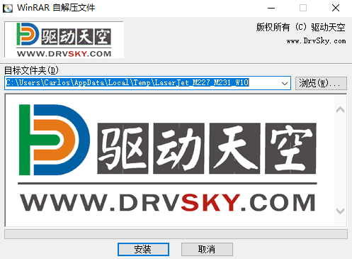
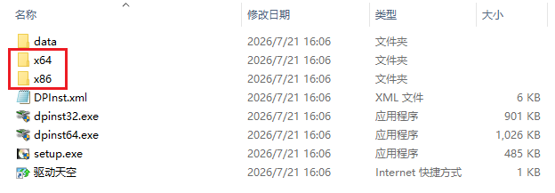
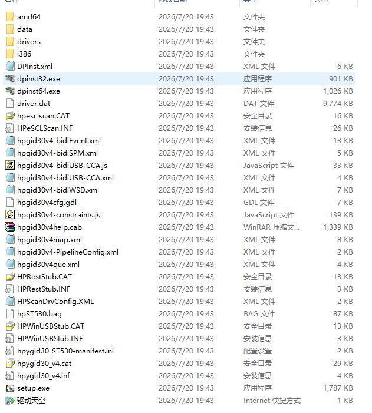
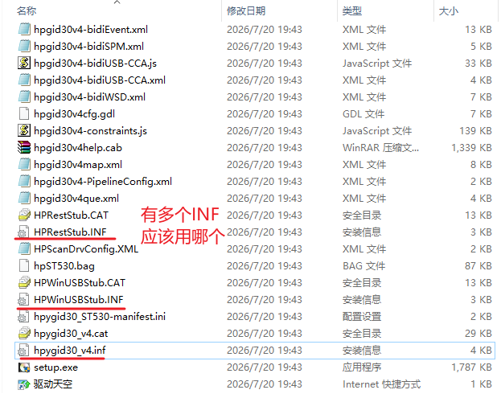
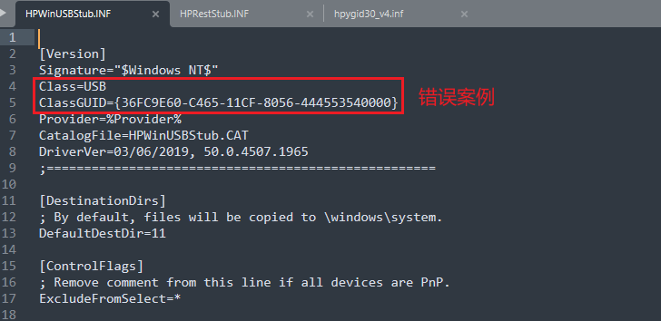
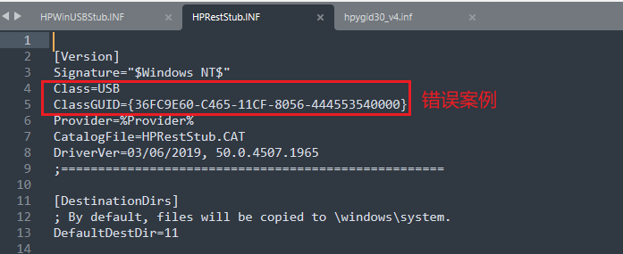
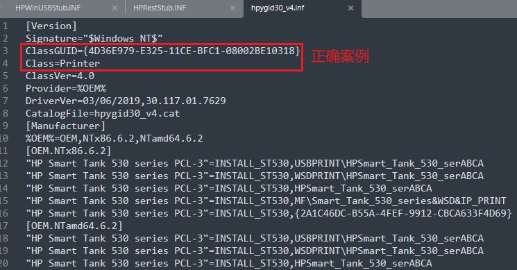
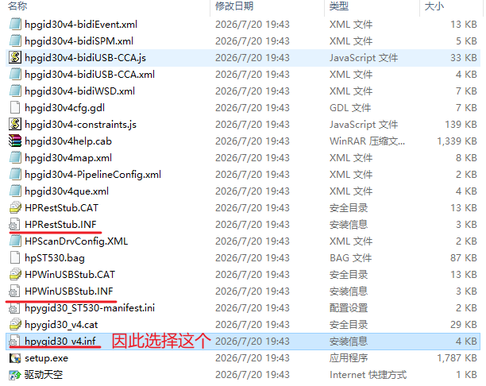
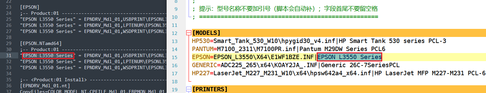
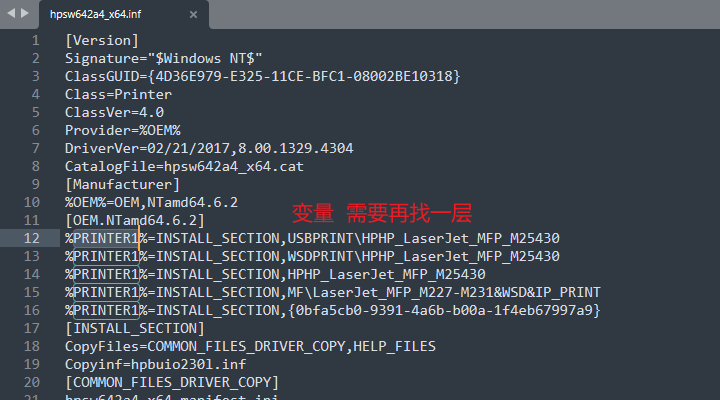

## 一、这是什么

一个纯 BAT 批处理脚本，双击运行后：

1. 自动检测内网配置服务器的连通性；
2. 从 SMB 共享读取 `printers.ini`，动态生成打印机菜单；
3. 用户输入编号选择打印机；
4. 自动创建 TCP/IP 打印端口、安装驱动、设置默认打印机、可选打印测试页。

脚本只使用系统自带组件（`ping`、`cscript`、`printui`、`wmic`、`reg`），不依赖任何第三方工具，兼容性高。

所有打印机 IP、驱动路径、驱动型号名称都维护在服务器上的 `printers.ini` 里，后面增减打印机、IP调整变化或新增型号，只改动配置文件，使用者无需重新下载新版脚本，维护者也无需修改脚本本身，只需维护共享上的配置文件即可。


---

## 二、文件说明

| 文件 | 说明 |
|---|---|
| `打印机连接工具_网络版.bat` | **当前推荐版本**。多次迭代的最新版本，从 SMB 共享读取 `printers.ini`，动态生成菜单；IP、驱动路径、型号名称均在线维护，打印机增加减少，IP地址变化，使用者无需重新下载脚本。 |
| `打印机连接工具_单机版.bat` | 单机离线版。IP 与型号全部硬编码在脚本内，历史旧版本。 |
| `README_打印机连接工具.md` | 本说明文档 |

## 三、实现原理与执行顺序

### 1. 脚本提权

脚本第 9-15 行检查当前是否以管理员身份运行；不是则用系统自带的 VBScript（`Shell.Application.ShellExecute ... "runas"`）
以管理员身份重新启动自己。**创建端口、安装驱动必须管理员权限。**

### 2. 网络连通检测

第 46-58 行先用 `ping -n 3 -w 2000 %SRV_IP%` 探测配置服务器。
服务器 IP 抽成独立变量 `SRV_IP`（第 28 行），共享路径由它拼接：

```bat
set "SRV_IP=192.168.7.230"
set "CFGFILE=\\%SRV_IP%\shared\打印机驱动\Windows\printers.ini"
set "DRV_PATH=\\%SRV_IP%\shared\打印机驱动\Windows\"
```

ping 不通直接打印错误并 `exit /b 1`，不会进入后续安装流程。

### 3. 读取并解析配置

第 69 行用一行 `for /f` 逐行读取 INI，交给 `:load_config_line` 子程序处理：

```bat
if exist "%CFGFILE%" for /f "usebackq eol=; tokens=1,* delims==" %%a in ("%CFGFILE%") do call :load_config_line "%%a" "%%b"
```

- `eol=;`：以分号开头的行视为注释；
- `delims==`：以第一个 `=` 切分为“键”和“值”；
- `:load_config_line` 根据当前所在区段，把行写入 `MODEL_n` 或 `PRINTER_n` 变量。

### 4. 动态渲染菜单

**菜单是动态渲染的**，不是写死在脚本里的固定列表：脚本启动时先读取 `printers.ini`，再由第 93-129 行遍历当前解析出的所有 `PRINTER_n` 变量，取出 `=` 右边第一个 `|` 之前的内容（即“选择名”），现场生成菜单项。

- 每次运行都按**当时**的 INI 内容重新渲染，增减打印机、改名或调整顺序都会立刻反映到菜单；
- 编号从 1 开始，`[0]` 为退出；
- 新增打印机只要在 INI 里加一行，菜单自动多一项，**脚本无需任何修改**。

### 5. 解析所选打印机

用户输入编号后：

- `:resolve_config`（第 305 行）在 `PRINTER_n` 中找到选择名，取出 `IP` 和 `型号标签`；
- `:found`（第 327 行）在 `MODEL_n` 中用型号标签找到 `驱动相对路径` 和 `驱动型号名称`。

### 6. 后台自动安装

工具的**核心命令**：

```bat
rem 创建 TCP/IP 端口（RAW，9100）
cscript //nologo %WINDIR%\System32\Printing_Admin_Scripts\zh-CN\prnport.vbs -a -r "%port%" -h %port%" -o raw -n 9100

rem 安装驱动并创建打印机队列
printui /if /f "%DRV_PATH%%drv_file%" /r "%port%" /m %model_name% /b %printer_name%
```

- `prnport.vbs`：系统自带，创建标准 TCP/IP 端口；
- `printui /if /f <inf> /r <端口> /m <驱动型号名称> /b <打印机名>`：用 INF 安装驱动并绑定端口。

> 以上命令均在后台静默执行，不会弹出安装向导图形界面；`//nologo` 用于屏蔽脚本宿主横幅。正常情况下约 30 秒完成，请勿关闭窗口。

打印机显示名称格式为 `选择名@驱动型号名称@IP`，便于识别。

全程无需人工点“下一步”，脚本调用系统自带命令**自动、静默地**完成“创建端口 + 安装驱动 + 建立打印机队列”。

### 7. 设置默认打印机

会先修改注册表 `LegacyDefaultPrinterMode=1`关闭让Windows自己管理打印机，再利用 `printui /n <打印机名> /y` 设为默认打印机；
最后询问是否打印测试页（`prnqctl.vbs -e`）。

---

## 四、如何使用

首次使用前需要进行相关环境准备工作。

### 4.1 配置共享目录

必须先有SMB共享服务器可以通过网络访问，并在里面建立新目录，专门用于驱动共享匿名访问在线获取，然后按 4.2 下载驱动、解压，并把文件放到对应的子目录下，从驱动提取相关关键信息配置在 `printers.ini` 中。（详细步骤见 4.2.6、4.2.7）。

共享服务器目录结构如下：

```
\\192.168.7.230\shared\打印机驱动\Windows\
├─ printers.ini                       ← 配置文件
├─ HP\Smart_Tank_530_W10\hpygid30_v4.inf
├─ EPSON\EPSON_L3550\X64\E1WF1BZE.INF
└─ ...
```

注意事项：

- 共享需允许普通域用户/来宾读取（至少读取 `printers.ini` 和 INF 所在目录）；
- 首次连接共享时，若系统提示凭据，请先手动访问一次 `\\192.168.7.230\shared` 并勾选“记住凭据”。

### 4.2 首次使用准备

> ***获取驱动文件与型号名称***
>
> 完成 4.1 的目录准备后，还需要为每个新型号准备驱动文件，最后在 `printers.ini` 中登记。首次上架某个型号时，按下面的顺序操作：
>
> 1. 从打印机驱动网下载驱动 exe；
> 2. 解压 exe，取得 INF 及同目录的 .dll、.cat、x64 等配套文件；
> 3. 把整个文件夹放到 4.1 建立的标准子目录下；
> 4. 打开 INF，找到“驱动型号名称”；
> 5. 在 `printers.ini` 中登记型号与打印机（INI 的格式与准备见 4.2.6）。
>
> 标准目录、驱动文件、`printers.ini` 三者缺一，`printui` 都会报“找不到驱动程序”，或菜单里看不到对应打印机。做好之后，**同型号的多台机器**都可直接复用共享上的驱动和配置，不必每台重复下载、解压；新机器只需运行脚本即可。

#### 4.2.1 准备流程总览

以下以 HP LaserJet MFP M227-M231 为例说明，其他型号的操作完全相同。

| 步骤 | 做什么 | 结果放在哪 |
|---|---|---|
| 1 | 到“打印机驱动网”下载对应型号的驱动 exe | 本机下载目录 |
| 2 | 解压 exe（自解压窗口会显示临时目录），拿到 INF 和配套文件 | 如 `C:\Users\你\AppData\Local\Temp\LaserJet_M227_M231_W10` |
| 3 | 把解压出来的**整个文件夹**复制到共享驱动目录 | `\\192.168.7.230\shared\打印机驱动\Windows\HP\M227\` |
| 4 | 打开 INF，找到“驱动型号名称” | 复制到内存剪贴板 |
| 5 | 在 `printers.ini` 中粘贴复制的型号名称（格式见 4.2.6） |  |

#### 4.2.2 下载驱动程序

1. 浏览器打开 **www.drvsky.com**（打印机驱动网），在搜索框输入打印机的**完整型号**，例如 `HP LaserJet MFP M227-M231`。
2. 在结果里选与目标系统匹配的版本：
   - 32 位系统选 x86/32 位，64 位系统选 x64/64 位（Win7/10/11 绝大多数是 64 位）；
   - 尽量选“官方驱动”“完整驱动”，不要只下“扫描/传真”组件。
3. 下载得到的一般是 `.exe` 自解压包，先放在本机，例如 `D:\下载\LaserJet_M227_M231_W10.exe`。

> 这个 exe 只是用来**提取文件**，不是让使用者真正安装，真正的安装由脚本调用 INF 完成。

#### 4.2.3 解压驱动文件

1. 双击 exe，弹出“解压文件”窗口；
2. 窗口上方“目标文件夹”会显示它准备释放到的临时目录，例如
   `C:\Users\Carlos\AppData\Local\Temp\LaserJet_M227_M231_W10`：

   

3. 建议点“浏览”改成好找的目录（如 `D:\drv\M227`）再点“安装/解压”；
   如果保持默认临时目录，解压完成后按窗口里显示的路径，到资源管理器地址栏粘贴进去就能找到；
4. 打开该文件夹，确认能看到 `.inf` 文件，并且同一目录下还有 `.dll`、`.cat`、`amd64`/`x64` 等子目录。
   **必须整个文件夹一起复制，不能只挑一个 inf**，否则装驱动时会提示缺少文件。

> 自解压窗口里的“安装”通常只是解压，也可能顺带启动厂商安装向导；如果弹出安装程序，直接关掉即可――我们只要文件。

#### 4.2.4 复制驱动文件

1. 在 `\\192.168.7.230\shared\打印机驱动\Windows\` 下按型号建目录。目录名建议“英文 + 型号”，例如 `HP\M227\`、`EPSON_L3550\X64\`；
2. 把 4.2.3 得到的**整个文件夹内容**复制进去，保持 inf 与 dll 的相对位置不变；
3. 最终结构类似：
```
\\192.168.7.230\shared\打印机驱动\Windows\
├─ printers.ini
├─ HP\M227\hpygid30_v4.inf
├─ HP\M227\...（dll、cat、x64 等配套文件）
└─ EPSON_L3550\X64\E1WF1BZE.INF
```
4. 记录 INF **相对** `...\Windows\` 的路径，必须以 `\` 开头，例如
   `\HP\M227\hpygid30_v4.inf`、`\EPSON_L3550\X64\E1WF1BZE.INF`。
   脚本会把它拼到 `DRV_PATH` 后面组成完整路径。

> 不要把安装包 exe 直接放进共享――脚本用的是 INF，不是 exe。

#### 4.2.5 确定 INF 文件与驱动型号名称

`/m` 参数要填的是“驱动型号名称”，必须和 INF 里登记的型号名一字不差，它不是 INF 文件名。一个驱动包解压后往往有多个 INF，先挑出真正的打印机 INF，再在文件里找到型号名，分三步做。

##### 第一步：找到 INF 并选对文件

解压出来的驱动包，目录结构并不统一：INF 有的藏在按位数分的子目录里，有的直接放在解压根目录。先确定 INF 在哪，再从中筛出真正的打印机 INF。

**先定位 INF 所在目录**，常见两种结构：

- **按系统位数分了子目录**：解压根目录下能看到 `x64`、`x86`（或 `amd64`、`i386`）文件夹，INF 在对应位数的目录里。目标机是 64 位就进 `x64`/`amd64`，32 位就进 `x86`/`i386`。下图根目录有 `data`、`x64`、`x86`，64 位系统应进 `x64`：

  

- **INF 直接放在根目录**：解压后根目录里虽然有 `amd64`、`i386`、`drivers` 等子目录，但当前系统对应的 INF 就在根目录，直接在这里找，不必进子目录：

  

找到 INF 后，同一目录里往往有好几个 INF，逐个用记事本打开，只看开头的 `[Version]` 段：

- 真正的打印机驱动 INF 必须有 `Class=Printer`，并带有 `ClassGUID={4D36E979-E325-11CE-BFC1-08002BE10318}`；
- `Class=USB`（`ClassGUID={36FC9E60-C465-11CF-8056-444553540000}`）的是 USB 辅助组件，扫描/传真等用途，**不能**用于安装打印机，直接跳过；
- 还要有 `[Manufacturer]` 段，能把厂商映射到具体的型号段，否则也不是打印机安装 INF。

下面以 HP Smart Tank 530 的驱动目录为例，按上述规则演示排除错误项、选出正确 INF 的推理顺序：

1. 目录里同时有 `HPWinUSBStub.INF`、`HPRestStub.INF`、`hpygid30_v4.inf` 等多个 INF，先全部列为候选：

   

2. 打开 `HPWinUSBStub.INF`，`Class=USB`、`ClassGUID={36FC9E60-...}`，属于 USB 辅助组件，排除：

   

3. 打开 `HPRestStub.INF`，同样是 `Class=USB`，继续排除：

   

4. 打开 `hpygid30_v4.inf`，`Class=Printer`、`ClassGUID={4D36E979-E325-11CE-BFC1-08002BE10318}`，正是打印机驱动 INF：

   

5. 因此这个驱动包应选择 `hpygid30_v4.inf`，它同时带有 `[Manufacturer]` 与 `[OEM.NTx86.6.2]`、`[OEM.NTamd64.6.2]` 型号段：

   

架构要与目标机器一致：`[Manufacturer]` 右侧带 `NTamd64` 是 64 位，带 `NTx86` 是 32 位，到对应目录（`X64`/`X86`）里选。以 EPSON L3550 为例，`X64` 目录下 `E1WF1BZE.INF` 是 `Class=Printer`，`EPPRNUT.INF`、`E_WGENEP.INF` 都是 `Class=USB`，可直接排除。

##### 第二步：在 INF 里定位型号名

1. 用记事本打开选中的打印机 INF，Ctrl+F 搜 `[Manufacturer]`。
2. 该段每行格式为 `厂商显示名 = 型号段名, 架构修饰`，例如：

```ini
[Manufacturer]
%EPSON% = EPSON,NTamd64
%OEM%   = OEM,NTamd64.6.2
%KM%    = Generic,NTamd64,NTamd64.6.0
```

   左侧的 `%EPSON%`、`%OEM%`、`%KM%` 只是厂商名，右侧的 `EPSON`、`OEM`、`Generic` 才是型号段名。把段名和架构拼起来去搜：`[EPSON.NTamd64]`、`[OEM.NTamd64.6.2]`、`[Generic.NTamd64]` 等。**不要拿左侧厂商名当型号名。**

3. 型号段里每行左侧就是型号名，常见两种写法：

   - **情况 A：键名直接就是型号名，带引号**。引号内的文字就是 `/m` 要填的值：

```ini
[EPSON.NTamd64]
"EPSON L3550 Series" = EPNDRV_Mdl_01, ...

[Generic.NTamd64]
"Generic 65C-9SeriesPCL" = ...
```

情况 A 的实例：EPSON 的型号段里，键名直接就是 `"EPSON L3550 Series"`，直接抄引号内文字即可：



再如 Generic 驱动的 `[Generic.NTamd64]` 段，键名是 `"Generic 26C-7SeriesPCL"` 这类直接型号名，把它原样写进 `printers.ini` 的 `[MODELS]` 中 `|` 的右边：

![情况 A：INF 中的直接型号名对应 printers.ini 的 [MODELS] 值](img/m1.png)

   - **情况 B：键名是变量 `%XXX%`**，需要再找一层。到同一文件的 `[Strings]` 段搜同名键，取它的值（引号内文字）：

```ini
[OEM.NTamd64.6.2]
%PRINTER1% = INSTALL_SECTION, ...

[Strings]
PRINTER1="HP LaserJet MFP M227-M231 PCL-6"
```

   于是这台 HP 的型号名是 `HP LaserJet MFP M227-M231 PCL-6`，而不是 `%PRINTER1%`。若 `[Strings]` 里的值又指向另一个变量，按同名继续找一次即可。

   实例：`hpsw642a4_x64.inf` 的 `[OEM.NTamd64.6.2]` 段里，型号行写成 `%PRINTER1% = INSTALL_SECTION, ...`，说明键名是变量，需要再找一层：

   

   再到同一文件的 `[Strings]` 段找 `PRINTER1=`，它的值 `"HP LaserJet MFP M227-M231 PCL-6"` 才是真实型号名；同段的 `DISK=` 只是安装盘描述，不要误当型号名：

   ![情况 B：到 [Strings] 段找 PRINTER1 的真实名称，注意不要误取 DISK](img/m2-2.png)

4. 只查型号行左侧真正出现的那个名字。变量可能叫 `PRINTER1`，也可能叫别的；`[Strings]` 里的 `DISK=` 只是“安装盘描述”，只有当型号行确实写成 `%DISK%` 时才拿它当型号名，否则不要用 `DISK`。

5. 型号段可能带系统版本后缀：`[Generic.NTamd64]`、`[Generic.NTamd64.6.0]`、`[Generic.NTamd64.6.1]`、`[Generic.NTamd64.6.2]`，分别对应不同 Windows 版本（`6.1` 约等于 Win7，`6.2` 约等于 Win10/11）。优先取与目标系统匹配的那一组，型号名通常相同。

6. 若存在本地化字符串段 `[Strings.0409]`（英文）、`[Strings.0804]`（中文）、`[Strings.0411]`（日文）等，按目标系统语言取对应值。

##### 第三步：确认型号名并填写

1. 最可靠的验证：打开“添加打印机”→“我需要的打印机不在列表中”→“通过手动设置添加”→“从磁盘安装”，浏览选中这个 INF，弹出的驱动列表中显示的名称，就是该 INF 的驱动型号名，也正是 `printui /m` 的匹配依据，照抄即可。
2. 抄写要求：大小写、空格、连字符、特殊字符全部**原样保留**，首尾不要多空格；写进 INI 时**不要加引号**（脚本会自动补）。若名称含中文，INI 必须是 ANSI/GBK。
3. 安装时报“找不到驱动”，通常是名称与系统显示不一致，回到第三步逐字核对。

示例：INF 中型号行为

```ini
[OEM.NTamd64.6.2]
%PRINTER1% = INSTALL_SECTION, ...
[Strings]
PRINTER1="HP LaserJet MFP M227-M231 PCL-6"
```

则 `printers.ini` 的 `[MODELS]` 写：

```ini
M227=\LaserJet_M227_M231_W10\x64\hpsw642a4_x64.inf|HP LaserJet MFP M227-M231 PCL-6
```

若型号行是情况 A 的直接引号写法，则 `|` 右边直接取引号内文字，例如 `EPSON L3550 Series`。

#### 4.2.6 配置文件准备与格式说明

驱动放到共享目录、并记下 INF 相对路径和“驱动型号名称”后，就可以在 `printers.ini` 中登记了。先了解文件位置、格式与字段。

##### 4.2.6.1 文件位置

- **位置**：共享父目录根部，即
  `\\192.168.7.230\shared\打印机驱动\Windows\printers.ini`，与各驱动子目录同级；
- **首次使用前由维护者创建**：在该目录新建文本文件，重命名为 `printers.ini`（注意扩展名不是 `.txt`）；
- 用记事本按下面的格式填写，保存时选择 **ANSI**（GBK）+ Windows 换行；
- 之后**新增/删除打印机、修改 IP、新增型号，只改这个文件**：使用者无需重新下载脚本，维护者也无需修改脚本本身。

##### 4.2.6.2 配置格式

```ini
; 必须以分号开头写注释；空行会被忽略
; 本文件必须保存为 ANSI/GBK 编码 + Windows(CRLF) 换行

[MODELS]
HP530=\Smart_Tank_530_W10\hpygid30_v4.inf|HP Smart Tank 530 series PCL-3
EPSON=\EPSON_L3550\X64\E1WF1BZE.INF|EPSON L3550 Series

[PRINTERS]
B10楼G区产品设计打印机=192.168.100.58|EPSON
B10楼H区IT中心打印机=192.168.150.195|GENERIC
```

##### 4.2.6.3 分隔符说明

INI 的基本语法是 `键=值`，所以：

| 区段 | 键 | 值 | 值内分隔 |
|---|---|---|---|
| `[MODELS]` | 型号标签（如 `EPSON`） | `驱动相对路径|驱动型号名称` | `\|` |
| `[PRINTERS]` | 选择名（显示在菜单里） | `IP|型号标签` | `\|` |

- 第一层必须是 `=`：这是“键/值”的分界，INI 解析器只认 `=`；
- 第二层用 `|`：一个值里要放两项内容时的内部分隔；
- `[MODELS]` 与 `[PRINTERS]` 用区段标题区分，两类数据字段不同也不会混淆；
- `型号标签` 是 `[PRINTERS]` 与 `[MODELS]` 之间的关联键，两边必须一致（如都写 `EPSON`）。

##### 4.2.6.4 字段说明

| 区段 | 键 | 值第 1 段 | 值第 2 段 |
|---|---|---|---|
| `[MODELS]` | 型号标签，自定义短名 | 驱动 INF 相对 `DRV_PATH` 的路径，**开头带 `\`** | 驱动型号名称，**与 Windows 驱动列表完全一致，不加引号** |
| `[PRINTERS]` | 菜单显示名 | 打印机 IP 地址 | 型号标签（对应 `[MODELS]` 的键） |

> 驱动相对路径是相对 `DRV_PATH`（默认 `\\192.168.7.230\shared\打印机驱动\Windows\`）而言。
> 例如 `\EPSON_L3550\X64\E1WF1BZE.INF` 实际展开为
> `\\192.168.7.230\shared\打印机驱动\Windows\\EPSON_L3550\X64\E1WF1BZE.INF`（双斜杠无影响）。

#### 4.2.7 配置printers.ini文件

驱动放到共享目录、并记下 INF 相对路径和“驱动型号名称”后，还必须在 `printers.ini` 里登记，脚本才能看到它们。格式与字段见 4.2.6，最少要加两处：

```ini
[MODELS]
M227=\HP\M227\hpygid30_v4.inf|HP LaserJet MFP M227-M231 PCL-6

[PRINTERS]
B10楼A区打印机=192.168.100.60|M227
```

- `[MODELS]`：左边是自定义**型号标签**（如 `M227`），右边是 `INF 相对路径|驱动型号名称`；
- `[PRINTERS]`：左边是**菜单显示名**，右边是 `打印机 IP|型号标签`；
- 同一型号有多台打印机时，`[MODELS]` 只写一条，`[PRINTERS]` 按每台 IP 各写一条，型号标签都指向同一个；
- 保存后重新运行脚本，菜单会**动态渲染**出新增的打印机，无需改脚本。

#### 4.2.8 核对准备结果

- [ ] 共享目录里能看到 INF，且同目录下 dll/cat/x64 齐全；
- [ ] INF 相对路径以 `\` 开头，能从 `...\Windows\` 拼出完整路径；
- [ ] “驱动型号名称”与系统驱动列表**逐字一致**，未加引号、无首尾空格；
- [ ] `printers.ini` 已存为 **ANSI(GBK) + CRLF**；
- [ ] `[PRINTERS]` 里引用的型号标签，在 `[MODELS]` 中确实存在。

#### 4.2.9 常见错误

- 名称不一致 → `printui` 提示找不到驱动 / 装完是别的型号；
- 多写引号 → 安装报错（INI 里不要引号）；
- 尾部空格 → 同名匹配失败，编辑时注意不要带空格；
- 只复制了 INF → 缺 dll/cat 报错，必须整个文件夹一起复制；
- 拿 exe 当驱动路径 → 脚本只认 INF，exe 需先解压。

### 4.3 日常使用步骤

1. 确认已接入内网，能访问 `\\192.168.7.230\shared`；
2. **双击** `打印机连接工具_网络版.bat`；
3. 出现 UAC 提示时选择「是」（脚本需要管理员权限）；
4. 等待“正在检测配置服务器网络连通性…”与“网络连接成功！！！”；
5. 在菜单中输入打印机前面的编号并回车（输入 `0` 退出）；
6. 等待创建端口、安装驱动（约 30 秒，提示“这不是卡住了”属正常）；
7. 安装完成后可选择是否打印测试页（10 秒内不选默认打印）。

运行成功后，打印机名称形如：`B10楼G区产品设计打印机@EPSON L3550 Series@192.168.100.58`。

---

## 五、常见问题

| 现象 | 排查方向 |
|---|---|
| 提示无法连接配置服务器 | 网线/内网、`SRV_IP` 是否正确、服务器是否开机、防火墙是否放行 |
| 配置文件读取失败/菜单为空 | `printers.ini` 是否存在、是否 ANSI/GBK、是否有 `[MODELS]`/`[PRINTERS]` 区段 |
| 菜单中文乱码 | `printers.ini` 被存成了 UTF-8，重新“另存为 ANSI” |
| 双击闪退 / 提示“不是内部或外部命令” | BAT 被存成了 LF 换行或 UTF-8，见下一节 |
| 驱动安装失败 | `驱动型号名称` 与系统驱动列表不一致，或 INF 路径不对 |
| 端口已存在 | 脚本的 `prnport -a` 对已存在端口会报错，可忽略或先删除旧端口 |
| Win11 无法访问共享 | 脚本已内置关闭 SMB 签名、启用来宾登录的命令；仍失败请检查组策略 |

---

## 六、编码与换行

本节务必阅读，否则极易导致乱码或脚本无法运行。

### 1. 默认编码

Windows 记事本里“ANSI”在简体中文系统上等于 **GBK（代码页 936）**，但：

- Windows 本身没有单一的“默认编码”；
- 各种编辑器/工具（VS Code、Git、部分脚本工具、AI 编辑工具）默认往往是 **UTF-8**；
- 一旦用 UTF-8 覆盖保存本脚本，BAT 里的中文会立刻乱码，甚至导致脚本无法运行。

**本工具的所有 BAT 文件与 `printers.ini` 都必须是 ANSI/GBK（代码页 936）编码。**

### 2. 换行符

- BAT 文件必须是 **CRLF**（`\r\n`）换行；
- 纯 **LF**（`\n`，Unix/Mac 换行）的 BAT 会让 `cmd.exe` 错误切分标签、括号块和 `for` 语句，
  表现为“不是内部或外部命令”、双击闪退、无法打开运行；
- `printers.ini` 也建议使用 CRLF，避免个别环境下行尾异常。

---

## 七、维护速查

### 7.1 脚本维护

脚本里可调项集中在开头，**按变量名定位即可，不必记行号**：

| 变量名 | 作用 | 什么时候改 |
|---|---|---|
| `SRV_IP` | 配置服务器 IP | 服务器更换 IP |
| `CFGFILE` | `printers.ini` 的完整路径，由 `SRV_IP` 拼接 | 配置文件改名或换目录 |
| `DRV_PATH` | 驱动父目录（共享路径），由 `SRV_IP` 拼接 | 共享目录改名或迁移 |
| `PRINTER_n` / `MODEL_n` | 运行时由 `printers.ini` 动态生成 | **不要手改**，改 INI 即可 |

> 修改脚本后，务必保持 **ANSI/GBK + CRLF**，否则中文乱码或无法运行（见第六章）。
> 除上述变量外，日常增减打印机、型号、驱动的操作都不需要改脚本。

### 7.2 配置维护

这是日常维护的主要工作。

| 要改什么 | 改哪里 |
|---|---|
| 新增/删除打印机 | `[PRINTERS]` 加/删一行 |
| 修改打印机 IP | `[PRINTERS]` 该行 `=` 右边、`|` 左边 |
| 打印机菜单显示名 | `[PRINTERS]` 该行 `=` 左边 |
| 新增/修改驱动型号 | `[MODELS]` 加/改一行 |
| 驱动 INF 路径 | `[MODELS]` 该行 `|` 左边（相对 `DRV_PATH`，以 `\` 开头） |
| 驱动型号名称 | `[MODELS]` 该行 `|` 右边（获取方法见 4.2.5） |

> `printers.ini` 必须保存为 **ANSI/GBK + CRLF**；改完保存即生效，使用者无需重新下载脚本，维护者也无需修改脚本本身。
